# Flashcards Project


stackId
## Overview:

The user needs a system that manages their revision flashcards.


## Application Requirements

We need a section that manages stacks of flashcards, a flashcards section that holds the front and back of flashcards and lastly a study section where users can test their knowledge on the flashcards in the database. All study sessions are recorded with a date and score.

The purpose of this project is to create a program that allows users to create flashcards for studying, The flashcards must be able to carry out create, view, delete and update operations. Each flashcard has a front and a back, the front of the flashcard contains the question being asked and the back of the flashcard would contain the answer to that question, this will be tested in the study sessions area. The flashcards once created are then organized into labelled stacks; For example there could be five flashcard cards all containing Physics questions, these flashcards would be stored into a stack named physics. 

Each stack must also have Create, View, delete and update capabilities. Th final area that needs creating is the study sessions area, this area of the program is for testing a users knowledge of their flashcard entry's by quizzing themselves, the study sessions area propmts a user to select and id of the stack they would like to study, after seleting the stack the user is then shoeing what the front of the flashcards say and asked to enter the back of said flashcard, if the user enters the back of the flashcard correctly they will be asked to enter whether they got the question right, if they did they are granted one point.

The final section of the main menu is the view previous stuy sessions area. This menu option shows users the Id, Score and date of their previous study session so users can track when they studied and the score they received.


The Stacks management area holds "Stacks" of flashcards within each stack, a stack is viewing as a collection of flashcards. The stack area manages the collection of stacks, this area includes a View all stacks option.


## How it works:

In the program their exists one main menu and four sub menus. The first main menu exists to ask the user what they would like to do, the first sub menu will ask the user if they want to Manage Revision Stacks, the second sub menu will ask the user to Manage Flashcards, the third sub menu is the study sessions area where study sessions will take place the fourth and final submenu is for viewing previous study sessions.

### Prerequisites

- [.NET 10 SDK](https://dotnet.microsoft.com/download) 


## Main menu:

There are five options, option zero is to close the program, option one is to manage the revision stacks, option two is to manage the flashcards, option three is go to the study session area and option four is to view previous study sessions.


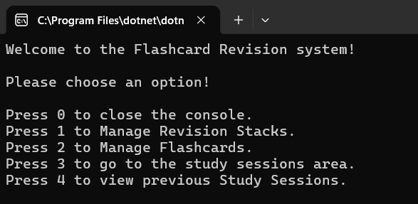


## Manage Stacks Menu

Inside the Manage revision stacks we open the sub menu with View, Insert, Delete and update options:

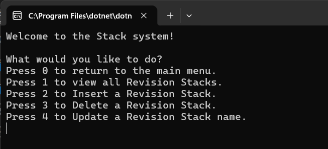


Option one shows the stacks currently in the database:

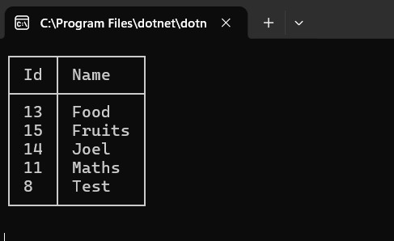


Option two shows the insert stack option.

The user is prompted to enter the name of the revision stack they would like to create.

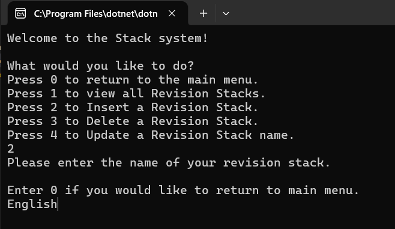


A record inserted message is shown when the record is entered.

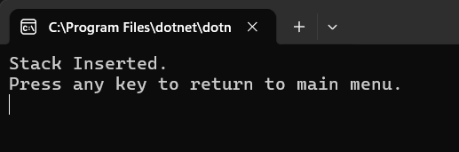


Option three shows the Delete stack option.

The user is shown the records in the database then asked to enter the name of the stack they'd like deleted.

Once entered the user receives a confirmation that the stack was deleted:


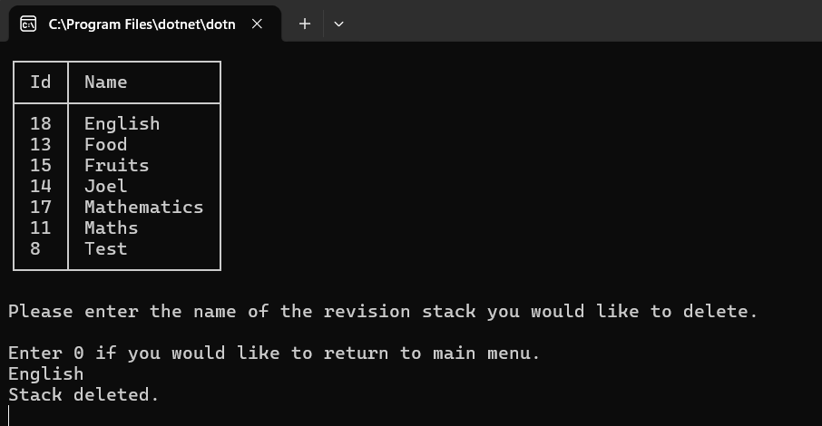


The fourth and final option in the stacks menu is the update stack option.

The user is shown a list of the stacks in the database and prompted to enter the name of the stack they'd like to update.

The user is then prompted to enter the name of the stack they'd like to update followed by the new name, once entered the user will receive a stack updated message if successful:


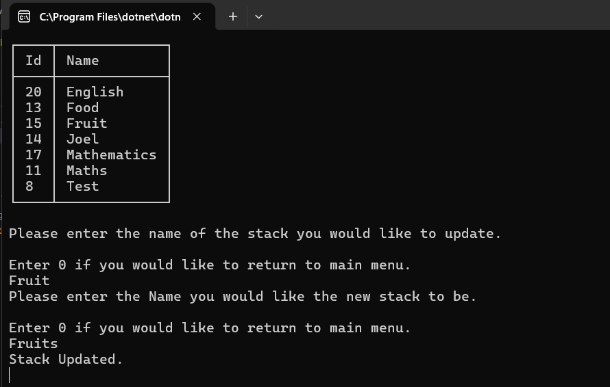


## Manage Flashcards Menu

The second sub menu is the Manage Flashcards menu.

The user is prompted to enter a stack id they would like to manage followed by the Create, View, Update and delete options:


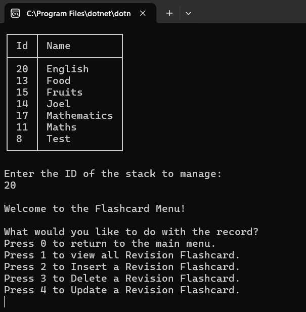


The insert menu prompts the user to enter the front and back of the flashcard, once inserted the user receives a verification message and returned to the main menu:


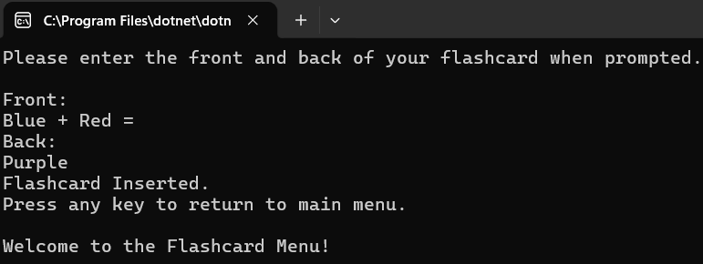


The delete menu shows the user the records in the database, the user is then prompted to enter the id they'd like to delete, if successful a verification message is shown:


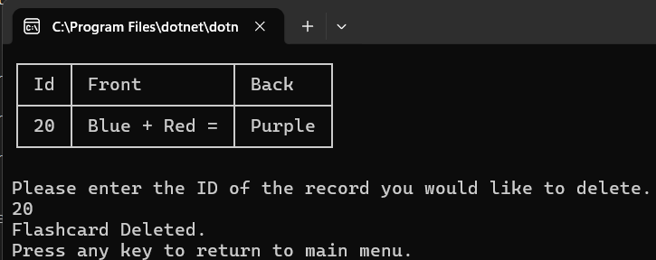


The fourth and final option is the update option.

The user is shown the records in the database. 

The user is then asked to enter a new front and back of the flashcard, if the update procedure is successful a message confirming this will be shown to the user:

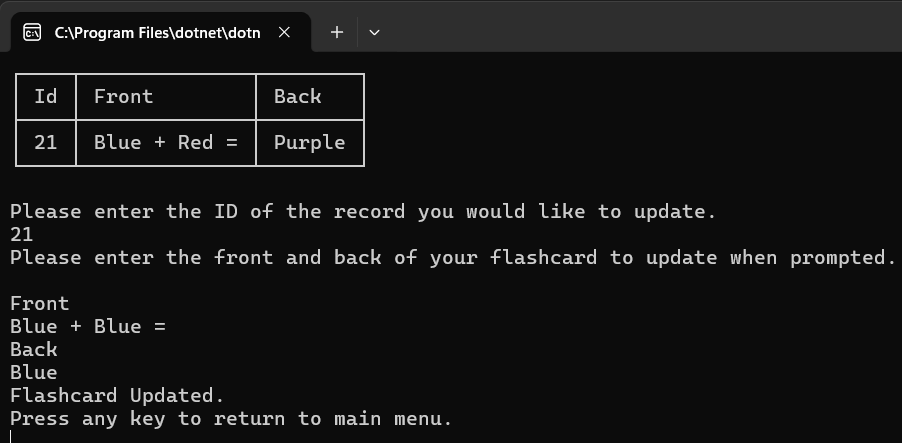


## Study Sessions Menu

The menu shows a list of the stacks in the database and asks the user which stack they'd like to study:

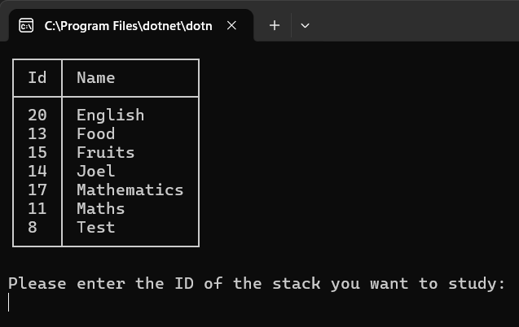


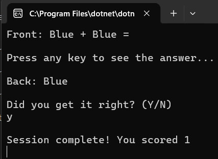


Once a id number is entered the user is shown the front of the flashcard and the user is asked to enter the back of the card, the user is then propmpted to press any key to see the answer.

The back of the flashcard is shown to the user and the user is asked if they got the flashcard answer right, if yes, the users score is incremented by one followed by a message showing the score.


## HOW TO RUN:

### Prerequisites

- [.NET 10 SDK](https://dotnet.microsoft.com/download)


## Database Setup

SQLserver Is used to manage the databases which was a bit of a change but it was nice to use.
Although I had some trouble setting it up initially.


## Connection String

The connection string is stored in appsettings.json the same way as the Coding Tracker. The format is different for SQL Server.

Server=Joel;Database=Flashcards;Integrated Security=True;TrustServerCertificate=True;

Server is the name of the local SQL Server. Database is the name of the database to connect to. Integrated Security means Windows Authentication is used instead of a username and password. TrustServerCertificate is required for local development to avoid certificate errors.


## Creating the tables

I created three tables using dapper, it was the same as the habit tracker in terms of creation however some of the syntax was different. I had three tables to create so I needed three methods which were CreateStackTable, CreateFlashcardTable and CreateStudySessionsTable.

These methods are called in main before anything else as these tables need to be created successfully before we carry out any operations.


# How it works:

## Managing Stacks

Manage stacks will take you to the manage stack menu where a user can view insert update or delete a revision stack.

The manage stack switch will take each user to a method created for them to complete a crud operation for example pressing 1 in the menu will take you to insert which will ask the user to insert a revision stack, the method will collect a name from the user and the name will be inserted into the database as the user has typed it.

This flow is the same for all crud operations, the delete method will ask for the name of the stack the user would like to delete, that name will be passed into the databaseController method responsible for database operations and will delete the name entered from stack where the name exists.


## Managing Flashcards

Manage Flashcards follows the same flow however we allow the user to search with id.

Similar to the coding tracker rowsaffected is used as a validation check to state if a stack is found, if a stack is found that meets the condition the stack operation will be carried out if not the user will be notified that no stack was found with that name.

As the management of flashcards is controlled by the stack table we first allow the user to view the stack records. We then prompt the user to Enter the ID of the stack to manage, we then set the value of stackId to the stack id the user enters after validating it.

Once we have the stackId the user wants to work with we can pass that into the ViewFlashcardRecords which needs to know the stack of flashcards you would like to view listing them before you carry out your update, delete or insert operations.


## Architectural Choices

userinput.cs 
all of the main menu methods are inside of userinput.cs
UserInput.cs never talks to the database directly. Its only job is gathering and validating input, then handing clean data over to DatabaseController to do the actual work.


## Static StackId Field 

I decided to create a static field for stackid as methods throughout the program would need it.
It is set once when the user enters the Manage Flashcards menu or the Study Sessions area, every flashcard and study session method reads from this field afterwards, so the user never has to re-enter which stack they are working with during that session.


## Database Controller Methods

As database controller methods need variables to work with, each databaseController method must have parameters that accept the variables entered into them.

For example the stack methods all need to accept a string parameter because they need to insert a name, delete a stack by name and update a stack to a new name from an oldname.


## Parameterised Queries

Like my coding tracker I adopted the use of parameterised queries instead of interpolated ones are learning the risks of using interpolated queries. Users can enter code that speaks directly to the database meaning users can enter malicious input that may be interpreted as SQL commands by the database which can result in data loss / data theft.

I started using parameterised queries to eliminate that risk as SQL parameters ensure that values supplied by users are handled as literal data instead of being executed as part of the query itself.


## Displaying Records

The get stack / flashcard methods are created to list the data in each of our databases inside of those methods using spectre. We first access the database then create a list that queries our model we then select everything in that database to display it.

We create a new instance of the table we then add columns we would like in our table.

I then used a foreach loop to add rows to the table, the rows are the variables in our models, stack would add Id and Name as rows, I used AnsiConsole.Write to write out all that we collected.


## Dapper

Dapper is also used here as well as throughout the program to simplify our database operations, in our habit tracker we used ADO.NET to create a connection, open the connection, create the command, create the command text, execute the query all before closing the query.

Dapper allows us to use ONE command that does all of this, connection.Execute does all of those operations in one go saving us lots of time and allows us to write and maintain clean code, I am excited to see how entity framework simplifies this even further.


## Study Sessions

Lastly we have the studysession section which is where I really understood the importance of the foreign key.

StackId is the thread that connects all three tables, it links flashcard to stack, and it links studySessions to Stack, allowing the study area to function as a separate part of the application while still relying on data the user enters in the userinput class.

The Stack table (to know which stack the user is studying) and the Flashcard table (to retrieve the cards belonging to that stack).

The study session feature loops through the flashcards in the selected stack one at a time. For each card it shows the front, asks the user if they know the answer, waits for the user to press a key, then reveals the back. The user marks whether they got it right or wrong. The score increments for each correct answer. At the end the session is saved to the database with the stack Id, the current date and time, and the final score is listed.


## Refactoring

After writing I realised that one of the requirements was to have the user search using the name of the stack rather than the id so I had to refactor some code.


## Reflection

The study sessions part was the toughest for me but after completing that I felt confident to move forward.

I enjoyed using sql server as it allows for more flexible querying of the tables, it allows you to order the data however you'd like for example

```
USE Flashcards;
SELECT * FROM Flashcard
order by id desc
```

allows you to order everything in the flashcard by ascending or descending order, grouping and where.


## Known Limitations

TRY CATCH
methods in controller if name already in db gets updated to same name exception happens.
TODO


D
